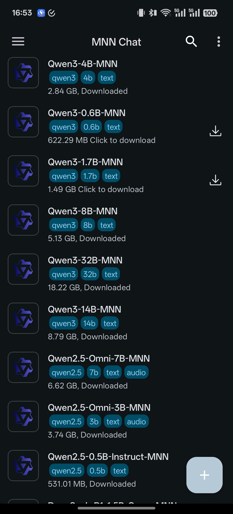
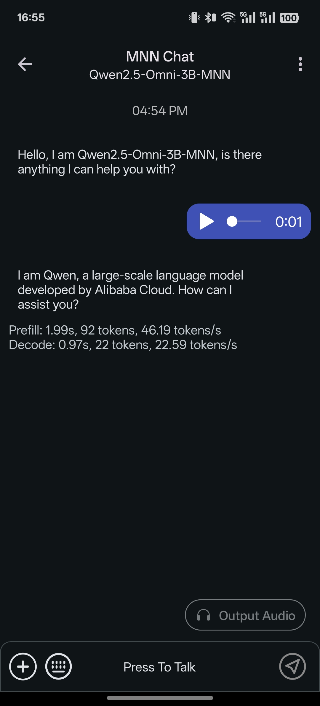
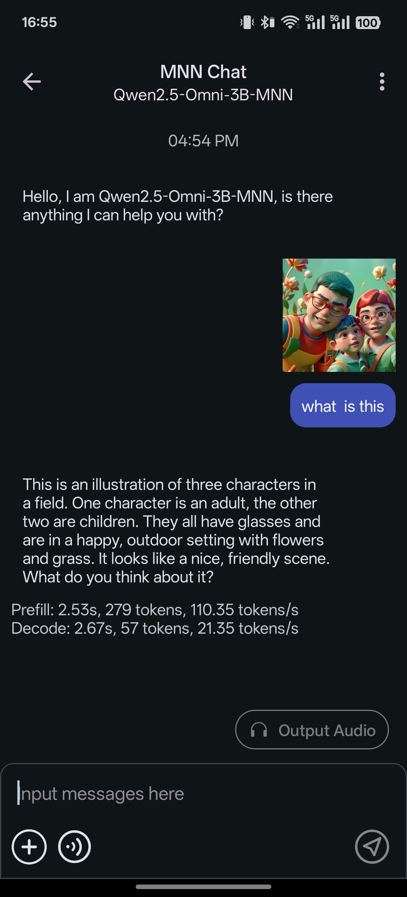
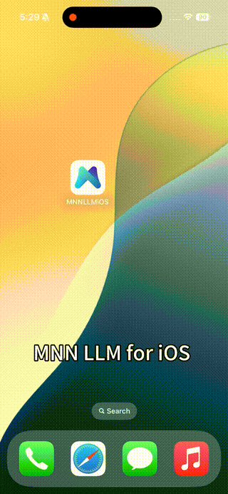
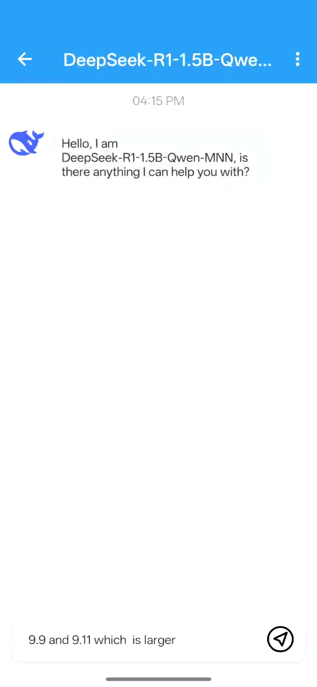
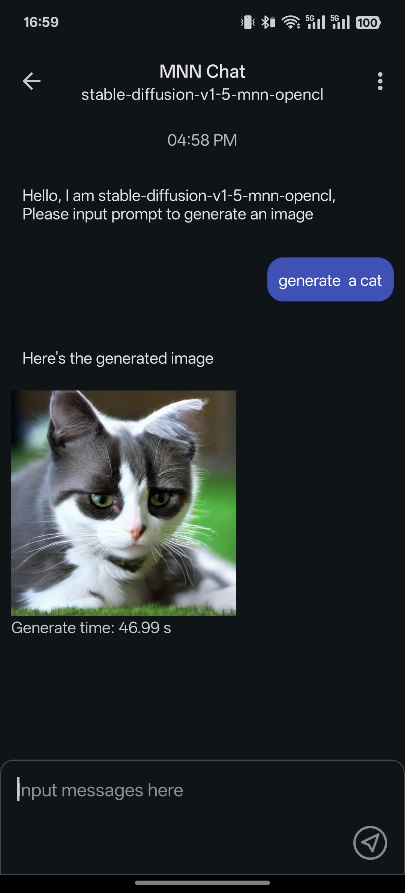
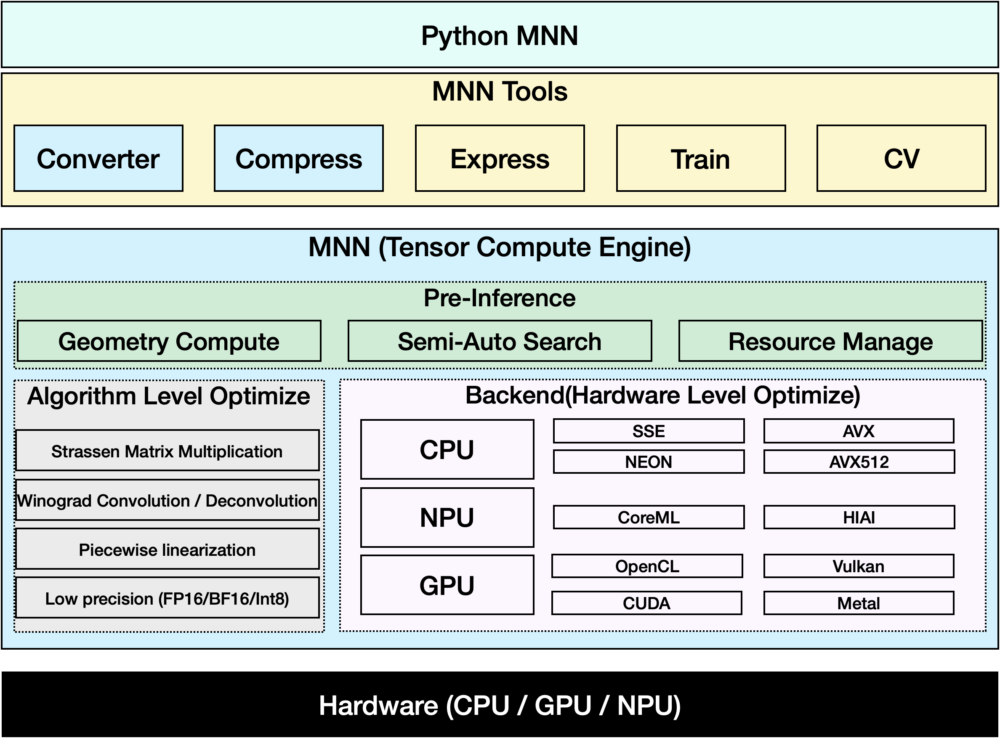

# MNN Android 云端构建仓库

> 本仓库复刻自 [alibaba/MNN](https://github.com/alibaba/MNN)，通过 GitHub Actions 在云端编译 Android App，无需本地配置 NDK / Android SDK。

[](https://github.com/ssmhdssmhd/MNN/actions/workflows/android-build.yml)
[](LICENSE.txt)

## 下载 APK

| App | 说明 | 下载 |
| --- | --- | --- |
| MNN Demo | 官方经典 Demo：摄像头实时图像分类、人像分割、OpenGL 渲染 | [MNN.Demo.latest.apk](https://github.com/ssmhdssmhd/MNN/releases/download/latest/MNN.Demo.latest.apk) |
| MnnLlmChat | 端侧大模型聊天 App（模型需在 App 内下载） | [MNN.Chat.latest.apk](https://github.com/ssmhdssmhd/MNN/releases/download/latest/MNN.Chat.latest.apk) |

历史构建产物见 [Releases](https://github.com/ssmhdssmhd/MNN/releases) 与 Actions 的 Artifacts。

> 两个 App 的桌面显示名称均为「沫兮本地化 AI」。MnnLlmChat 的 API 服务默认绑定 `0.0.0.0`（局域网可访问）并开启 CORS；设置页实时显示访问地址（如 `http://<设备局域网IP>:8080/v1`），点击即可复制，浏览器打开根路径 `/` 即可直接使用内置测试页。
>
> API 服务以前台服务常驻：退出对话页不会自动关闭，只有点击「停止」或从通知栏停止才会结束；启动失败会在通知栏显示具体原因，端口占用时自动重试。
>
> MnnLlmChat「存储管理」页可设置模型存储路径（内置 / 外置 / 自定义），修改路径时会自动把旧路径下的模型迁移到新路径，避免模型丢失。
>
> MnnLlmChat「模型市场」搜索框可直接联网搜索 HuggingFace（含 `taobao-mnn` 在内的任意 MNN 仓库）与魔搭模型，结果按「本地目录匹配 → 在线搜索结果」排序，在线结果可直接在列表中下载运行。
>
> MnnLlmChat API 设置支持开启 OpenAI Responses API（`/v1/responses`），保存设置后自动重启服务生效；服务同时支持按请求 `model` 字段在多模型间自动切换。
>
> API 会话默认复用应用内已调优的模型配置并开启 Prompt Cache，多轮对话只处理新增内容，响应更快。
>
> API 设置页新增「端点速度」：显示最近一次请求的首字延迟、生成速度（tok/s）与总耗时，并可点「测速」直接向本机端点发送一条最小请求实测延迟。
>
> API 服务同时提供 Ollama 兼容接口：`GET /api/tags` 返回模型列表、`POST /api/pull` 流式拉取模型；浏览器打开 `http://<设备IP>:<端口>/v1/responses` 可直接查看 Ollama 格式模型列表（`POST /v1/responses` 仍是 Responses API）。
>
> API 请求中的历史助手消息会先剥离 `<think>...</think>` 思考内容再送入模型（客户端若保留并重发推理内容，会导致上下文膨胀、长上下文响应变慢）；仅含思考、无正文的历史消息会被丢弃。
>
> 设置页可开启「启动时自动清空日志」，避免日志持续膨胀。
>
> MnnLlmChat「关于」页会自动检测本仓库最新 Release：有新版时弹窗提示，同意后自动下载并拉起安装；下载支持断点续传，暂停后进度保留。
>
> 「关于」页的「公告」自动读取本仓库 [CHANGELOG.md](CHANGELOG.md)，展示当前版本的更新内容，版本升级后自动变化；离线时回退到构建时内置的副本。

## 版本

- 当前版本：见 [VERSION](VERSION)
- 更新日志：见 [CHANGELOG.md](CHANGELOG.md)

## 工作流说明

工作流文件：[.github/workflows/android-build.yml](.github/workflows/android-build.yml)

1. `build_mnn_libs`：编译 Android 原生库
   - `arm64-v8a`：LLM / Transformer / OpenCV / OpenCL，供 Demo 与 MnnLlmChat 使用
   - `armeabi-v7a`：供 32 位设备使用
2. `build_demo_models`：编译 Linux 版 `MNNConvert`，下载并转换 Demo 所需模型
3. `build_demo_apk`：组装 `jniLibs` 与模型，Gradle 编译 Debug APK
4. `build_chat_apk`：使用预编译 `libMNN.so`，Gradle 编译 `standardDebug` APK
5. `publish`：把 APK 发布到 `latest` Release；推送 `v*` 标签时同时创建对应版本 Release

触发方式：推送到 `main`、推送 `v*` 标签，或手动 `workflow_dispatch`。

## 本地构建（可选）

```bash
# 1. 编译 Android 原生库（需 ANDROID_NDK）
cd project/android && mkdir -p build_64 && cd build_64
../build_64.sh "-DMNN_JNI=TRUE -DMNN_BUILD_LLM=true -DMNN_OPENCL=true -DMNN_SEP_BUILD=OFF -DCMAKE_INSTALL_PREFIX=."
make install

# 2. 编译 Demo
cd project/android/demo
cp -r ../build_64/lib/* app/libs/arm64-v8a/
./gradlew assembleDebug
```

应用图标来自 [MXLOGO](https://github.com/ssmhdssmhd/MXLOGO) 仓库。

---


---
[](LICENSE.txt)
[](https://mnn-docs.readthedocs.io/en/latest/)
[](README_CN.md)
[](README_TW.md)
[](README_JP.md)
[](http://www.mnn.zone)
[](https://zread.ai/alibaba/MNN)

[](./apps/Android/MnnLlmChat/README.md)
[](./apps/Android/Mnn3dAvatar/README.md)
[](./apps/sana/README.md)

## News 🔥
- [2026/07/22] MNN 3.6.1 is released with a new 🚀 Hexagon backend, enabling accelerated model inference on Qualcomm Hexagon DSPs. [Learn more](./source/backend/hexagon/README.md).

<details>
<summary> History News </summary>

- [2026/03/05] Support Qwen3.5 Series.
<p align="center">
  
  
  
</p>

- [2026/02/13] MNN-Sana-Edit-V2 is now available at [apps](./apps/sana/README.md), offering cartoon-style photo editing based on Sana.
<p align="center">
  
</p>

- [2025/10/16] Support Qwen3-VL Series.
- [2025/06/11] New App MNN TaoAvatar released, you can talk with 3DAvatar offline with LLM, ASR, TTS, A2BS and NNR models all run local on your device!! [MNN TaoAvatar](./apps/Android/Mnn3dAvatar/README.md)
<p align="center">
  
</p>

- [2025/05/12] android app support qwen2.5 omni 3b and 7b [MNN Chat App](./apps/Android/MnnLlmChat/README.md#releases).
<p align="center">
  
  
  
</p>

- [2025/04/30] android app support qwen3 and dark mode [MNN Chat App](./apps/Android/MnnLlmChat/README.md#releases).
<p align="center">
  
</p>

- [2025/02/18] iOS multimodal LLM App is released [MNN LLM iOS](./apps/iOS/MNNLLMChat/README.md).
<p align="center">
  
</p>

- [2025/02/11] android app support for [deepseek r1 1.5b](./apps/Android/MnnLlmChat/README.md#releases).
<p align="center">
  
</p>

- [2025/01/23] We released our full multimodal LLM Android App:[MNN-LLM-Android](./apps/Android/MnnLlmChat/README.md). including text-to-text, image-to-text, audio-to-text, and text-to-image generation.
<p align="center">
  
  
  
  
</p>
</details>

## Intro
MNN is a highly efficient and lightweight deep learning framework. It supports inference and training of deep learning models and has industry-leading performance for inference and training on-device. At present, MNN has been integrated into more than 30 apps of Alibaba Inc, such as Taobao, Tmall, Youku, DingTalk, Xianyu, etc., covering more than 70 usage scenarios such as live broadcast, short video capture, search recommendation, product searching by image, interactive marketing, equity distribution, security risk control. In addition, MNN is also used on embedded devices, such as IoT.

[MNN-LLM](./transformers/README.md) is a large language model runtime solution developed based on the MNN engine. The mission of this project is to deploy LLM models locally on everyone's platforms(Mobile Phone/PC/IOT). It supports popular large language models such as Qianwen, Baichuan, Zhipu, LLAMA, and others. [MNN-LLM User guide](https://mnn-docs.readthedocs.io/en/latest/transformers/llm.html)

[MNN-Diffusion](https://github.com/alibaba/MNN/tree/master/transformers/diffusion) is a stable diffusion model runtime solution developed based on the MNN engine. The mission of this project is to deploy stable diffusion models locally on everyone's platforms. [MNN-Diffusion User guide](https://mnn-docs.readthedocs.io/en/latest/transformers/diffusion.html)



Inside Alibaba, [MNN](https://mp.weixin.qq.com/s/5I1ISpx8lQqvCS8tGd6EJw) works as the basic module of the compute container in the [Walle](https://mp.weixin.qq.com/s/qpeCETty0BqqNJV9CMJafA) System, the first end-to-end, general-purpose, and large-scale production system for device-cloud collaborative machine learning, which has been published in the top system conference OSDI’22. The key design principles of MNN and the extensive benchmark testing results (vs. TensorFlow, TensorFlow Lite, PyTorch, PyTorch Mobile, TVM) can be found in the OSDI paper. The scripts and instructions for benchmark testing are put in the path “/benchmark”. If MNN or the design of Walle helps your research or production use, please cite our OSDI paper as follows:

    @inproceedings {proc:osdi22:walle,
        author = {Chengfei Lv and Chaoyue Niu and Renjie Gu and Xiaotang Jiang and Zhaode Wang and Bin Liu and Ziqi Wu and Qiulin Yao and Congyu Huang and Panos Huang and Tao Huang and Hui Shu and Jinde Song and Bin Zou and Peng Lan and Guohuan Xu and Fei Wu and Shaojie Tang and Fan Wu and Guihai Chen},
        title = {Walle: An {End-to-End}, {General-Purpose}, and {Large-Scale} Production System for {Device-Cloud} Collaborative Machine Learning},
        booktitle = {16th USENIX Symposium on Operating Systems Design and Implementation (OSDI 22)},
        year = {2022},
        isbn = {978-1-939133-28-1},
        address = {Carlsbad, CA},
        pages = {249--265},
        url = {https://www.usenix.org/conference/osdi22/presentation/lv},
        publisher = {USENIX Association},
        month = jul,
    }


## Documentation and Workbench
MNN's docs are in place in [Read the docs](https://mnn-docs.readthedocs.io/en/latest).

You can also read docs/README to build docs's html.

MNN Workbench could be downloaded from [MNN's homepage](http://www.mnn.zone), which provides pretrained models, visualized training tools, and one-click deployment of models to devices.

## Key Features
### Lightweight
- Optimized for devices, no dependencies, can be easily deployed to mobile devices and a variety of embedded devices.
- iOS platform: static library size will full option for armv7+arm64 platforms is about 12MB, size increase of linked executables is about 2M.
- Android platform: core so size is about 800KB (armv7a - c++_shared).
- Using MNN_BUILD_MINI can reduce package size by about 25%, with a limit of fixed model input size
- Support FP16 / Int8 quantize, can reduce model size 50%-70%

### Versatility
- Supports `Tensorflow`, `Caffe`, `ONNX`,`Torchscripts` and supports common neural networks such as `CNN`, `RNN`, `GAN`, `Transformer`.
- Supports AI model with multi-inputs or multi-outputs, every kind of dimension format, dynamic inputs, controlflow.
- MNN supports approximate full OPs used for the AI Model. The converter supports 178 `Tensorflow` OPs, 52 `Caffe` OPs, 163 `Torchscripts` OPs, 158 `ONNX` OPs.
- Supports iOS 8.0+, Android 4.3+, and embedded devices with POSIX interface.
- Supports hybrid computing on multiple devices. Currently supports CPU and GPU.


### High performance
- Implements core computing with lots of optimized assembly code to make full use of the ARM / x64 CPU.
- Use Metal / OpenCL / Vulkan to support GPU inference on mobile.
- Use CUDA and tensorcore to support NVIDIA GPU for better performance
- Convolution and transposition convolution algorithms are efficient and stable. The Winograd convolution algorithm is widely used to better symmetric convolutions such as 3x3,4x4,5x5,6x6,7x7.
- Twice speed increase for the new architecture ARM v8.2 with FP16 half-precision calculation support. 2.5 faster to use sdot for ARM v8.2 and VNNI.

### Ease of use
- Support use MNN's OP to do numerical calculating like numpy.
- Support lightweight image process module like OpenCV, which is only 100k.
- Support build model and train it on PC / mobile.
- MNN Python API helps ML engineers to easily use MNN to infer, train, and process images, without dipping their toes in C++ code.

The Architecture / Precision MNN supported is shown below:

- S ：Support and work well, deeply optimized, recommend to use
- A ：Support and work well, can use
- B ：Support but has bug or not optimized, no recommend to use
- C ：Not Support

| Architecture / Precision |  | Normal | FP16 | BF16 | Int8 |
| --- | --- | --- | --- | --- | --- |
| CPU | Native | B | C | B | B |
|  | x86/x64-SSE4.1 | A | C | C | A |
|  | x86/x64-AVX2 | S | C | C | A |
|  | x86/x64-AVX512 | S | C | C | S |
|  | ARMv7a | S | S (ARMv8.2) | S | S |
|  | ARMv8 | S | S (ARMv8.2) | S(ARMv8.6) | S |
| GPU | OpenCL | A | S | C | S |
|  | Vulkan | A | A | C | A |
|  | Metal | A | S | C | S |
|  | CUDA | A | S | C | A |
| NPU | CoreML | A | C | C | C |
|  | HIAI | A | C | C | C |
|  | NNAPI | B | B | C | B |
|  | QNN | C | B | C | C |


## Tools

Base on MNN (Tensor compute engine), we provided a series of tools for inference, train and general computation.

- MNN-Converter: Convert other models to MNN models for inference, such as Tensorflow(lite), Caffe, ONNX, Torchscripts. And do graph optimization to reduce computation.
- MNN-Compress: Compress model to reduce size and increase performance / speed
- MNN-Express: Support model with controlflow, use MNN's OP to do general-purpose computing.
- MNN-CV: An OpenCV-like library, but based on MNN and then much more lightweight.
- MNN-Train: Support train MNN model.

## How to Discuss and Get Help From the MNN Community

The group discussions are predominantly Chinese. But we welcome and will help English speakers.

Dingtalk discussion groups:

Group #4 (Available): 160170007549

Group #3 (Full)

Group #2 (Full): 23350225

Group #1 (Full): 23329087

## Historical Paper

The preliminary version of MNN, as mobile inference engine and with the focus on manual optimization, has also been published in MLSys 2020. Please cite the paper, if MNN previously helped your research:


    @inproceedings{alibaba2020mnn,
      author = {Jiang, Xiaotang and Wang, Huan and Chen, Yiliu and Wu, Ziqi and Wang, Lichuan and Zou, Bin and Yang, Yafeng and Cui, Zongyang and Cai, Yu and Yu, Tianhang and Lv, Chengfei and Wu, Zhihua},
      title = {MNN: A Universal and Efficient Inference Engine},
      booktitle = {MLSys},
      year = {2020}
    }


## License
Apache 2.0

## Acknowledgement
MNN participants: Taobao Technology Department, Search Engineering Team, DAMO Team, Youku and other Alibaba Group employees.

MNN refers to the following projects:
- [Caffe](https://github.com/BVLC/caffe)
- [flatbuffer](https://github.com/google/flatbuffers)
- [gemmlowp](https://github.com/google/gemmlowp)
- [Google Vulkan demo](http://www.github.com/googlesamples/android-vulkan-tutorials)
- [Halide](https://github.com/halide/Halide)
- [Mace](https://github.com/XiaoMi/mace)
- [ONNX](https://github.com/onnx/onnx)
- [protobuffer](https://github.com/protocolbuffers/protobuf)
- [skia](https://github.com/google/skia)
- [Tensorflow](https://github.com/tensorflow/tensorflow)
- [ncnn](https://github.com/Tencent/ncnn)
- [paddle-mobile](https://github.com/PaddlePaddle/paddle-mobile)
- [stb](https://github.com/nothings/stb)
- [rapidjson](https://github.com/Tencent/rapidjson)
- [pybind11](https://github.com/pybind/pybind11)
- [pytorch](https://github.com/pytorch/pytorch)
- [bolt](https://github.com/huawei-noah/bolt)
- [libyuv](https://chromium.googlesource.com/libyuv/libyuv)
- [libjpeg](https://github.com/libjpeg-turbo/libjpeg-turbo)
- [opencv](https://github.com/opencv/opencv)
- [onnxruntime](https://github.com/microsoft/onnxruntime)
